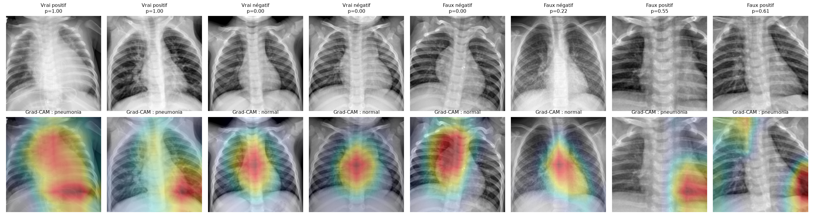
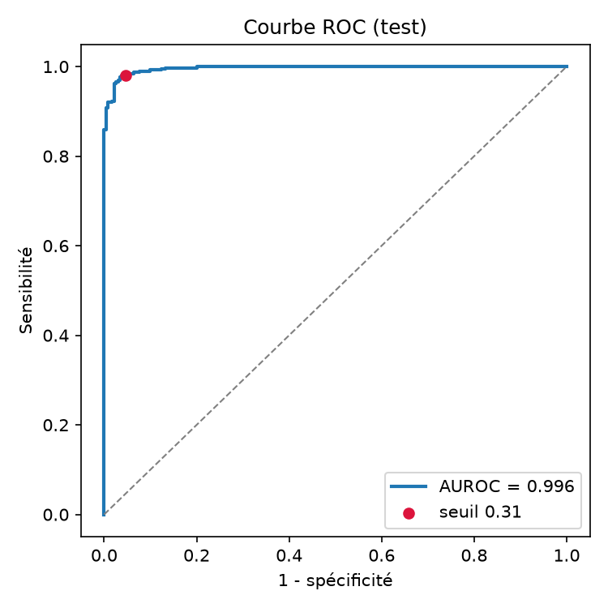
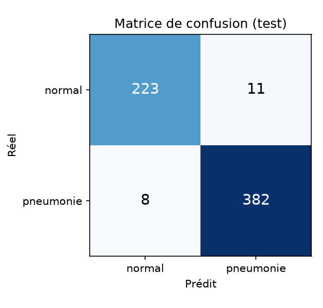

# MedXRay — détection de pneumonie servie en production, avec Grad-CAM

Un modèle de vision médicale **sorti du notebook** : entraînement reproductible, évaluation
honnête, API FastAPI testée, image Docker durcie et explications Grad-CAM.

> ⚠️ Projet pédagogique. **Ce n'est pas un dispositif médical** : ne pas utiliser pour un diagnostic.



📄 **Rapport scientifique complet** (méthodes, équations, résultats, analyse d'erreurs, discussion) : [`rapport.md`](rapport.md)

---

## Sommaire

1. [Résultats](#1-résultats)
2. [Démarrage rapide](#2-démarrage-rapide)
3. [Utiliser l'API](#3-utiliser-lapi)
4. [Architecture](#4-architecture)
5. [Choix de conception (le « pourquoi »)](#5-choix-de-conception-le--pourquoi-)
6. [Reproduire l'entraînement](#6-reproduire-lentraînement)
7. [Qualité logicielle](#7-qualité-logicielle)
8. [Limites et pistes d'amélioration](#8-limites-et-pistes-damélioration)

---

## 1. Résultats

Jeu de **test** PneumoniaMNIST (624 radios). Le modèle et le seuil sont figés *avant* d'évaluer
sur le test. Intervalles de confiance à 95 % par bootstrap.

| Métrique | Valeur | IC 95 % |
|---|---:|---:|
| **AUROC** | **0,996** | [0,994 – 0,998] |
| **Sensibilité** (pneumonies détectées) | **97,9 %** (382 / 390) | [96,5 – 99,2] |
| **Spécificité** (normaux reconnus) | **95,3 %** (223 / 234) | [92,3 – 97,7] |
| Exactitude | 97,0 % | [95,5 – 98,2] |
| VPP / VPN | 97,2 % / 96,5 % | — |
| F1 | 0,976 | — |

Seuil de décision : **0,310**, choisi sur la validation (sensibilité ≥ 95 %), puis figé.
Contrôle de validité Grad-CAM : corrélation de Spearman de **0,012** entre les cartes du modèle
entraîné et celles du modèle randomisé. Les explications dépendent donc bien des poids appris.

**Lecture critique.** Ces scores sont élevés, mais ils mesurent une performance *intra-domaine* :
train et test viennent du même hôpital pédiatrique. Ils ne disent rien de la généralisation à
d'autres populations. Les baselines publiées dans le papier MedMNIST v2 sont plus basses, mais
elles ont été obtenues à partir d'images 28×28 sur-échantillonnées : elles ne sont pas
directement comparables.

**Ce que montre Grad-CAM** ([galerie](reports/gradcam_examples.png)) :
- *Pneumonie* : la carte se concentre sur les champs pulmonaires, surtout les bases, ce qui est
  cohérent avec des opacités.
- *Normal* : la carte se concentre sur le médiastin et la silhouette cardiaque. Le modèle semble
  s'appuyer sur la netteté des contours centraux, ce qui n'est pas la démarche d'un radiologue.
- *Faux positifs* : la carte s'allume parfois en **bordure d'image**. C'est un indice possible
  d'apprentissage par raccourci (cadrage, artefacts), qui serait à investiguer, par exemple avec
  un masquage des bords ou une validation externe.
- Un faux négatif à p ≈ 0,00 suggère aussi du bruit d'annotation, connu sur ce jeu de données.

| Courbe ROC | Matrice de confusion |
|---|---|
|  |  |

Le détail complet est dans [`reports/metrics.json`](reports/metrics.json) et dans la
[model card](docs/model_card.md).

## 2. Démarrage rapide

### Avec Docker (recommandé)

```bash
docker compose up --build
```

Ensuite, ouvrir <http://localhost:8000> pour la page de démo (glisser-déposer une radio), ou
<http://localhost:8000/docs> pour la documentation OpenAPI interactive.

> Les poids (`models/model.pt`, ~45 Mo) ne sont pas versionnés dans git. Il faut d'abord les
> produire avec `medxray-train` (§6) ou les récupérer depuis la release GitHub.

### En local (développement)

```bash
python -m venv .venv
.venv/Scripts/activate            # Windows ; sous Linux/macOS : source .venv/bin/activate
pip install torch==2.14.1 torchvision==0.29.1 --index-url https://download.pytorch.org/whl/cpu
pip install -c requirements/constraints.txt -e ".[train,dev]"
uvicorn --factory medxray.api.main:create_app --reload
```

## 3. Utiliser l'API

| Méthode | Route | Rôle |
|---|---|---|
| `GET` | `/health` | *Liveness* : le processus répond |
| `GET` | `/ready` | *Readiness* : le modèle est chargé |
| `GET` | `/v1/model` | Version, seuil, métriques, empreinte SHA-256 des poids |
| `POST` | `/v1/predict` | Classification d'une radio (PNG/JPEG) |
| `POST` | `/v1/explain` | Prédiction + heatmap Grad-CAM (`?format=png` pour l'image brute, `?target=normal\|pneumonia`) |

```bash
curl -F "file=@radio.png;type=image/png" http://localhost:8000/v1/predict
```

```json
{
  "label": "pneumonia",
  "probability_pneumonia": 0.973,
  "threshold": 0.31,
  "model_version": "1.0.0",
  "inference_ms": 41.3,
  "disclaimer": "Outil de démonstration à visée pédagogique. ..."
}
```

```bash
curl -F "file=@radio.png;type=image/png" "http://localhost:8000/v1/explain?format=png" -o heatmap.png
```

Les erreurs sont explicites et typées : `415` pour un type non supporté, `413` pour un fichier
trop volumineux, `422` pour une image illisible ou trop petite, `503` si le modèle n'est pas
chargé.

## 4. Architecture

```
├── src/medxray/
│   ├── preprocessing.py   # SOURCE UNIQUE du prétraitement (train ET serving)
│   ├── model.py           # XRayClassifier (features | head) + checkpoint sûr
│   ├── gradcam.py         # Grad-CAM sans hook, thread-safe
│   ├── inference.py       # Predictor : indépendant de FastAPI
│   ├── config.py          # Settings via variables d'environnement
│   ├── api/               # FastAPI : factory, routes, schémas, logs JSON, page de démo
│   └── training/          # data, train, metrics, evaluate (extras [train])
├── tests/                 # 47 tests, sans données ni modèle entraîné
├── configs/train.yaml     # hyperparamètres versionnés
├── docs/model_card.md     # usage prévu, données, limites, éthique
├── reports/               # métriques et figures générées
├── Dockerfile             # multi-stage, CPU, non-root, healthcheck
└── .github/workflows/     # CI : lint, types, tests, build + smoke test Docker
```

Flux d'une requête `/v1/explain` :

```
upload ─► validation (type, taille, contenu réel) ─► niveaux de gris ─► recadrage carré + 224
       ─► features(x) = A ─► head(A) = logit ─► ∂logit/∂A ─► Grad-CAM ─► overlay PNG
```

Les couches sont séparées volontairement : `inference.Predictor` ne connaît pas HTTP, et l'API
ne connaît pas PyTorch au-delà du `Predictor`. On peut donc réutiliser la même inférence en
batch ou en CLI, et tester chaque couche isolément.

## 5. Choix de conception (le « pourquoi »)

C'est la partie qui distingue un projet de production d'un notebook.

### Données et évaluation

- **PneumoniaMNIST 224×224** : téléchargeable sans compte, sous licence CC BY 4.0, avec des
  splits **officiels**. N'importe qui peut reproduire les chiffres, et il n'y a pas de fuite
  patient introduite par un split fait maison.
- **Le seuil est une décision clinique, pas 0,5.** En dépistage, un faux négatif coûte plus
  cher qu'un faux positif. On impose une sensibilité ≥ 95 % sur la **validation**, on maximise
  ensuite la spécificité, puis on fige ce seuil dans le checkpoint. Le test n'intervient dans
  **aucune** décision.
- **Sélection de modèle sur l'AUROC de validation**, une métrique indépendante du seuil, avec
  early stopping.
- **Intervalles de confiance** : sur 624 images, « 93 % de sensibilité » n'a pas de sens sans
  sa marge d'incertitude.
- **Déséquilibre** (74 % de pneumonies) : `pos_weight = n_neg / n_pos` dans la BCE.
- **Augmentations plausibles** : pas de flip horizontal (le cœur est à gauche), seulement des
  rotations et translations faibles.

### Prétraitement

- **Un seul module** (`preprocessing.py`) pour l'entraînement et la production. Le *training/serving
  skew* est la première cause de dégradation silencieuse d'un modèle déployé.
- Une radio plein format reçoit **la même géométrie** que les images MedMNIST (recadrage carré
  centré, puis redimensionnement). Un test vérifie que l'image affichée correspond pixel pour
  pixel à ce que voit le modèle.
- **PNG 16 bits** (courant en radiologie) : remise à l'échelle min-max. Un `convert("L")` naïf
  saturerait l'image en blanc. Ce cas est couvert par un test.

### Grad-CAM

- **Sans hook.** Les implémentations usuelles stockent les activations dans un attribut via des
  hooks. Sous FastAPI, plusieurs threads partagent le modèle, et deux requêtes concurrentes
  pourraient alors échanger leurs heatmaps. Ici, le modèle est découpé en `features` et `head`,
  et on calcule `∂head(A)/∂A` avec `torch.autograd.grad`. C'est une fonction pure, sans état
  partagé.
- **Coût quasi nul** : `A` est détaché du backbone, donc la rétropropagation ne traverse que la
  tête.
- **Testé analytiquement** : sur des activations synthétiques dont on connaît la réponse,
  Grad-CAM doit allumer exactement la bonne zone.
- **Contrôle de validité (Adebayo et al., 2018)** : on randomise les dernières couches et on
  vérifie que les cartes changent. Une carte qui ne bouge pas ne ferait que montrer des contours.
- Possibilité d'expliquer l'autre classe (`?target=`), pour voir ce qui plaide *contre* la décision.

### API

- **Endpoints de calcul en `def`, pas en `async def`.** L'inférence est CPU-bound : FastAPI
  l'exécute dans son pool de threads, et `/health` reste réactif. Un `async def` bloquerait la
  boucle événementielle pendant le calcul.
- **Modèle chargé une fois** dans le `lifespan`, et **fail fast** : si les poids sont absents, le
  conteneur ne démarre pas. Mieux vaut un redémarrage visible qu'un service « up » qui répond 500.
- **App factory** (`create_app(settings, predictor)`) : les tests injectent leur propre modèle,
  sans monkey-patching.
- **Validation défensive des uploads** : Content-Type, taille lue au plus `limite + 1` octet,
  puis **contenu réel** (un BMP renommé en `.png` est rejeté). Protection contre les
  *decompression bombs* et prise en compte de l'orientation EXIF.
- **`/health` (liveness) distinct de `/ready` (readiness)**, conformément aux sondes Kubernetes.
- **Traçabilité** : `/v1/model` expose la version, le seuil, les métriques et le **SHA-256 des
  poids servis**. On sait toujours exactement quel modèle a répondu.
- **Logs JSON** avec `X-Request-ID` (assaini contre l'injection) et latence. **Aucune donnée
  patient** n'est journalisée ni conservée.

### Sécurité et conteneur

- **`torch.load(weights_only=True)`** : un checkpoint `.pt` classique est un pickle, donc
  potentiellement du code arbitraire. Un test vérifie qu'un objet piégé est refusé.
- **Build multi-stage**, **PyTorch CPU** (~2,5 Go économisés par rapport à la roue CUDA),
  versions figées (`requirements/constraints.txt`).
- **Utilisateur non-root**, `HEALTHCHECK`, et dans `docker-compose` : système de fichiers en
  lecture seule, `cap_drop: ALL`, `no-new-privileges`, limites CPU et mémoire.
- **Un worker par conteneur** et `OMP_NUM_THREADS` fixé : on scale par réplicas. PyTorch voit
  les CPU de l'hôte, pas le quota du conteneur, ce qui provoque sinon une sur-souscription.
- **Poids intégrés à l'image** : une image correspond à une version de modèle, immuable et
  déployable telle quelle.

## 6. Reproduire l'entraînement

```bash
medxray-train --config configs/train.yaml          # télécharge les données (~214 Mo), entraîne, évalue
medxray-evaluate --checkpoint models/model.pt      # ré-évalue un checkpoint publié, régénère reports/
medxray-train --limit 64 --epochs 1 --output models/smoke.pt   # smoke test (~1 min)
```

Graine fixée et algorithmes déterministes. Tous les hyperparamètres sont dans
[`configs/train.yaml`](configs/train.yaml). Entraînement de référence : 8 époques, ~1 h 55 sur CPU (4 cœurs / 8 threads), meilleure époque : 7.

## 7. Qualité logicielle

```bash
pytest                 # 47 tests : prétraitement, Grad-CAM, checkpoint, inférence, API
ruff check src tests   # lint
ruff format --check src tests
mypy                   # typage strict
```

La CI GitHub Actions exécute ces vérifications, puis **construit l'image Docker**, la démarre,
attend `/ready`, envoie une vraie requête `/v1/predict` et vérifie que le conteneur tourne en
non-root. Les tests utilisent un modèle aux poids aléatoires : la CI ne télécharge ni données
ni modèle.

## 8. Limites et pistes d'amélioration

Voir la [model card](docs/model_card.md) pour le détail.

- **Domain shift** : données pédiatriques d'un seul hôpital. Il faudrait une validation externe
  (par exemple sur CheXpert ou NIH ChestX-ray14).
- **Calibration** des probabilités (Platt / isotone) et suivi du Brier score.
- **Détection hors distribution** pour refuser les images qui ne sont pas des radios thoraciques.
  Exemple vécu : un dessin de deux ellipses noires obtient P(pneumonie) = 99,8 %. Un
  classifieur répond toujours, même quand la question n'a pas de sens.
- **DICOM** (pydicom) avec anonymisation, pour un contexte hospitalier réel.
- **Monitoring en production** : métriques Prometheus (latence, distribution des scores) et
  détection de dérive.
- **Export ONNX / TorchScript** pour une image plus légère et une inférence plus rapide.
- **Authentification et rate limiting**, à placer dans une API gateway devant le service.

## Références

- Selvaraju et al., *Grad-CAM: Visual Explanations from Deep Networks via Gradient-based Localization*, ICCV 2017.
- Adebayo et al., *Sanity Checks for Saliency Maps*, NeurIPS 2018.
- Yang et al., *MedMNIST v2*, Scientific Data 2023.
- Kermany et al., *Identifying Medical Diagnoses and Treatable Diseases by Image-Based Deep Learning*, Cell 2018.
- Mitchell et al., *Model Cards for Model Reporting*, FAT* 2019.

## Licence

Code sous licence MIT. Données PneumoniaMNIST sous licence CC BY 4.0.
