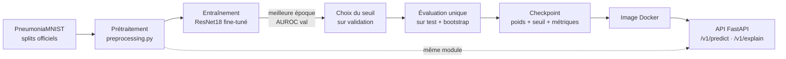
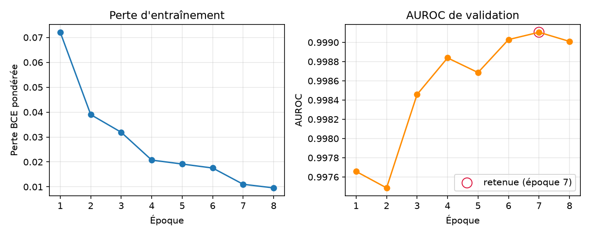
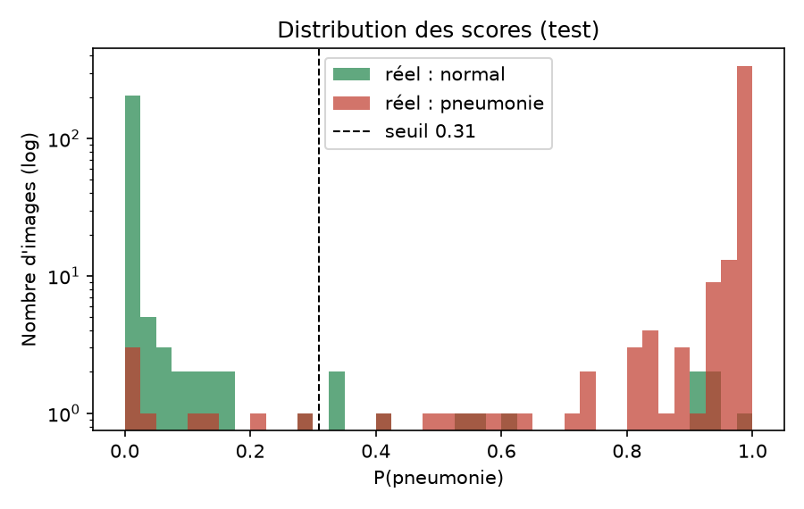
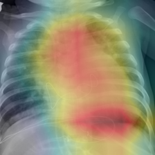

# Rapport technique — MedXRay

## Détection de pneumonie sur radiographie thoracique : de l'entraînement au déploiement d'un modèle explicable

**Auteur** : Mamadou Moussa  ·  **Date** : 23 octobre 2026  ·  **Version du modèle** : 1.0.0
(SHA-256 des poids : `db8eed2a901d8801…`)

> Travail à visée pédagogique. Le modèle décrit ici **n'est pas un dispositif médical** et n'a
> fait l'objet d'aucune validation clinique.

---

### Résumé

**Contexte.** La pneumonie est une cause majeure de mortalité infantile, et la radiographie
thoracique est l'examen de première intention pour la diagnostiquer. Les modèles de deep learning
atteignent de bonnes performances sur ce problème dans des notebooks. Leur mise en production,
avec des garanties de reproductibilité, de robustesse et d'explicabilité, est en revanche rarement
démontrée.

**Objectif.** Concevoir, entraîner, évaluer et **déployer** un classifieur binaire
(normal / pneumonie), avec une explication visuelle de chaque prédiction, sous la forme d'un
service web conteneurisé et testé.

**Méthodes.** Un ResNet18 pré-entraîné sur ImageNet a été fine-tuné sur PneumoniaMNIST
224×224 (5 856 radiographies pédiatriques, splits officiels). Le seuil de décision a été choisi
sur la validation pour garantir une sensibilité ≥ 95 %. Les performances ont été estimées une
seule fois sur le test, avec des intervalles de confiance à 95 % par bootstrap. Les explications
reposent sur Grad-CAM, implémenté sans état partagé et soumis à un test de randomisation. Le
modèle est servi par une API FastAPI dans une image Docker durcie, et validé par 47 tests
automatisés et une intégration continue.

**Résultats.** Sur le jeu de test (n = 624), le modèle obtient une AUROC de **0,996**
[IC 95 % : 0,994 – 0,998], une sensibilité de **97,9 %** [96,5 – 99,2] et une spécificité de
**95,3 %** [92,3 – 97,7]. Le test de randomisation confirme que les cartes Grad-CAM dépendent
des poids appris (corrélation de Spearman ρ = 0,012). Le service répond en 67 ms (prédiction) et
191 ms (prédiction + explication) sur 2 cœurs CPU, et occupe moins de 400 Mo de RAM. Les
probabilités servies par l'API sont identiques, au millionième près, à celles de l'évaluation
hors-ligne.

**Conclusion.** La chaîne complète, des données au service déployé, est reproductible et
vérifiable. Les performances, très élevées, sont à interpréter comme des performances
*intra-domaine*. L'analyse des erreurs et des cartes Grad-CAM met en évidence des signes
d'apprentissage par raccourci et l'absence de rejet des entrées hors distribution : ce sont les
deux priorités avant tout usage réel.

---

## Table des matières

1. [Introduction](#1-introduction)
2. [Matériel](#2-matériel)
3. [Méthodes](#3-méthodes)
4. [Résultats](#4-résultats)
5. [Discussion](#5-discussion)
6. [Limites](#6-limites)
7. [Conclusion et perspectives](#7-conclusion-et-perspectives)
8. [Reproductibilité](#8-reproductibilité)
9. [Références](#9-références)
10. [Annexes](#10-annexes)

---

## 1. Introduction

### 1.1 Contexte

La lecture d'une radiographie thoracique demande un radiologue, ressource rare dans de nombreux
contextes. Un outil d'aide au tri pourrait signaler les examens suspects en priorité. Dans ce
cadre, deux exigences dépassent la seule performance du modèle :

1. **Le coût des erreurs est asymétrique.** Une pneumonie non détectée (faux négatif) peut
   retarder un traitement. Une fausse alerte (faux positif) coûte seulement une relecture.
2. **La décision doit pouvoir être examinée.** Un score seul ne permet pas au clinicien de juger
   si le modèle a regardé les poumons ou un artefact de l'image.

### 1.2 Problématique

Le passage du notebook à la production fait apparaître des problèmes absents de
l'expérimentation :

- le **décalage de prétraitement** entre entraînement et production (*training/serving skew*) ;
- la **concurrence** entre requêtes ;
- la **validation d'entrées** arbitraires ;
- la **sécurité** du chargement des poids ;
- la **traçabilité** du modèle servi ;
- la **reproductibilité** des chiffres annoncés.

### 1.3 Objectifs et critères de réussite

| # | Objectif | Critère mesurable |
|---|---|---|
| O1 | Modèle performant | AUROC test ≥ 0,95 |
| O2 | Respect de la contrainte clinique | Sensibilité ≥ 95 % fixée sur la validation, sans utiliser le test |
| O3 | Évaluation honnête | Test utilisé une seule fois, intervalles de confiance rapportés |
| O4 | Explications fiables | Cartes Grad-CAM sensibles à la randomisation des poids |
| O5 | Service de production | API conteneurisée, tests automatisés, CI, latence < 500 ms sur CPU |
| O6 | Cohérence entraînement / production | Probabilités identiques hors-ligne et via l'API |

---

## 2. Matériel

### 2.1 Données

Le jeu utilisé est **PneumoniaMNIST** (collection MedMNIST v2 [3]), en résolution **224×224**.
Il dérive du jeu de Kermany et al. [4] : radiographies thoraciques de face d'**enfants de 1 à 5 ans**,
acquises au Guangzhou Women and Children's Medical Center (Chine), et étiquetées par des
médecins.

**Tableau 1 – Répartition des données (splits officiels).**

| Split | Images | Normal | Pneumonie | Prévalence |
|---|---:|---:|---:|---:|
| Entraînement | 4 708 | 1 214 | 3 494 | 74,2 % |
| Validation | 524 | 135 | 389 | 74,2 % |
| Test | 624 | 234 | 390 | 62,5 % |
| **Total** | **5 856** | 1 583 | 4 273 | 73,0 % |

**Justification du choix :**

- **Reproductibilité** : téléchargement automatique sans compte (~214 Mo), licence CC BY 4.0.
  Tout relecteur peut refaire l'expérience.

- **Splits officiels** : la version Kaggle d'origine ne comporte que 16 images de validation, ce
  qui pousse à refaire un split et expose à une fuite de patients entre ensembles. Les splits
  MedMNIST sont utilisés **sans modification**.

- **Taille compatible** avec un entraînement sur CPU.

**Point d'attention.** La prévalence du test (62,5 %) diffère de celle de l'entraînement
(74,2 %). Le test reprend en effet le jeu de test original de Kermany, constitué séparément. Ce
léger décalage de distribution sera utile à l'interprétation des résultats (§5.2).

### 2.2 Environnement

| Composant | Version |
|---|---|
| Matériel | CPU 4 cœurs / 8 threads, sans GPU |
| Python | 3.12 |
| PyTorch / torchvision | 2.14.1 (CPU) / 0.29.1 |
| FastAPI / Uvicorn | 0.161.1 / 0.54.0 |
| scikit-learn | 1.9.1 |
| Docker | 28.3.3 |

Toutes les versions des dépendances sont figées dans `requirements/constraints.txt`.

---

## 3. Méthodes

### 3.1 Vue d'ensemble



*Figure 1 – Chaîne complète. Le même module de prétraitement sert à l'entraînement et à
l'inférence en production.*

Le code est organisé en couches indépendantes (annexe C). `preprocessing.py`, `model.py` et
`gradcam.py` sont les briques de base. `inference.py` les assemble sans rien connaître de HTTP.
`api/` expose le service, et `training/` n'est jamais importé par l'API.

### 3.2 Prétraitement

**Principe : une source unique.** Toute transformation d'image est définie dans un seul module,
utilisé à la fois par l'entraînement et par l'API. Un prétraitement subtilement différent entre
les deux environnements est l'une des causes les plus fréquentes de dégradation silencieuse d'un
modèle déployé.

**Pipeline d'inférence (déterministe) :**

1. **Décodage et validation** : seuls les formats PNG et JPEG sont acceptés, vérifiés sur le
   contenu réel du fichier et non sur l'extension. La taille minimale est de 64 px de côté. La
   taille maximale est de 40 Mpx, vérifiée sur l'en-tête avant décodage pour se protéger des
   *decompression bombs*.
2. **Orientation EXIF** appliquée, pour gérer les photos de radiographies prises au smartphone.
3. **Conversion en niveaux de gris.** Les images 16 bits, courantes en radiologie, sont remises à
   l'échelle par min-max : $x' = 255 \cdot \frac{x - \min x}{\max x - \min x}$. Une conversion
   naïve tronquerait toutes les valeurs supérieures à 255 et produirait une image blanche.
4. **Recadrage carré centré** (redimensionnement du petit côté à 224, puis découpe centrale
   224×224). Cette géométrie reproduit celle utilisée par MedMNIST pour constituer le jeu : une
   radiographie plein format envoyée à l'API est vue comme les images d'entraînement.
5. **Réplication sur 3 canaux** et **normalisation ImageNet** (μ = (0,485 ; 0,456 ; 0,406),
   σ = (0,229 ; 0,224 ; 0,225)), imposées par le backbone pré-entraîné.

**Augmentations (entraînement seulement).** Elles sont choisies pour rester *cliniquement
plausibles* :

- recadrage aléatoire couvrant 85 à 100 % de l'image ;
- rotation de ±7° et translation de ±3 % ;
- variation de luminosité et de contraste de ±15 %.

Le **flip horizontal est volontairement exclu** : l'anatomie thoracique n'est pas symétrique (le
cœur est à gauche) et une image retournée ne correspond à aucun patient réel.

### 3.3 Modèle

**Architecture.** On utilise un ResNet18 [5] (~11,2 M de paramètres) initialisé avec les poids
ImageNet, réorganisé en deux blocs explicites :

```
features : conv1 → bn1 → ReLU → maxpool → layer1 → layer2 → layer3 → layer4   → A ∈ ℝ^{512×7×7}
head     : AdaptiveAvgPool → Flatten → Dropout(0,2) → Linear(512 → 1)          → logit z
sortie   : P(pneumonie) = σ(z) = 1 / (1 + e^{-z})
```

**Justification :**

- **Transfer learning** : avec ~4 700 images, un entraînement depuis zéro sur-apprendrait. Les
  filtres de bas niveau appris sur ImageNet (bords, textures) se transfèrent bien à l'imagerie
  médicale.

- **Taille adaptée au déploiement sur CPU** : checkpoint de 45 Mo, inférence de quelques dizaines
  de millisecondes. Des architectures plus lourdes (ResNet50, ViT) ne se justifient pas quand
  l'AUROC de validation dépasse déjà 0,99.

- **Un seul logit** plutôt qu'un softmax à deux classes : le problème est binaire, et cette forme
  rend explicite que la décision repose sur un **seuil**, choisi ensuite selon l'objectif clinique
  (§3.5).

- **Découpage features/head** : il permet un calcul de Grad-CAM sans *hooks* (§3.7).

### 3.4 Entraînement

**Fonction de perte.** On utilise une entropie croisée binaire pondérée pour compenser le
déséquilibre des classes :

$$\mathcal{L} = -\frac{1}{N}\sum_{i=1}^{N} \Big[ w_+ \, y_i \log \sigma(z_i) + (1-y_i)\log\big(1-\sigma(z_i)\big) \Big]$$

$$w_+ = \frac{N_{\text{normal}}}{N_{\text{pneumonie}}} = \frac{1\,214}{3\,494} = 0{,}347$$

**Optimisation :**

- AdamW (*weight decay* 10⁻⁴), lots de 32 images.
- **Taux d'apprentissage différenciés** : 10⁻⁴ pour le backbone pré-entraîné, qui doit peu
  s'éloigner de son initialisation, et 10⁻³ pour la tête, initialisée aléatoirement.

- Décroissance cosinus sur 8 époques au maximum.

**Sélection du modèle.** À chaque époque, on calcule l'AUROC sur la validation. On conserve les
poids de la meilleure époque, avec un early stopping de patience 3. L'AUROC est préférée à
l'exactitude car elle **ne dépend pas du seuil**, qui n'est fixé qu'après.

**Reproductibilité.** La graine est fixée (42) et les algorithmes sont déterministes
(`torch.use_deterministic_algorithms`). Tous les hyperparamètres sont versionnés dans
`configs/train.yaml` (annexe A).

### 3.5 Choix du seuil de décision

En dépistage, le seuil par défaut de 0,5 n'a aucune justification clinique. Le seuil τ est choisi
**sur la validation uniquement**, en imposant une sensibilité cible puis en maximisant la
spécificité :

$$\tau^* = \max \Big\{ \tau \;:\; \text{Se}_{\text{val}}(\tau) \geq 0{,}95 \Big\}$$

Le plus grand seuil qui respecte la contrainte est aussi celui qui produit le moins de faux
positifs. τ* est ensuite **figé dans le checkpoint**, avec les poids. L'API le lit dans le
checkpoint et ne le code jamais en dur.

### 3.6 Protocole d'évaluation

1. Le jeu de test n'intervient dans **aucune décision** : choix de l'époque, du seuil et des
   hyperparamètres se font sans lui. Il est évalué **une seule fois**, avec le modèle et le seuil
   figés.
2. **Métriques** (VP, FP, VN, FN au seuil τ*) :
    - Sensibilité Se = VP / (VP + FN)
    - Spécificité Sp = VN / (VN + FP)
    - VPP = VP / (VP + FP) et VPN = VN / (VN + FN)
    - F1 = 2VP / (2VP + FP + FN)
    - AUROC et AUPRC, indépendantes du seuil.
3. **Incertitude** : intervalles de confiance à 95 % par bootstrap percentile, avec 1 000
   ré-échantillonnages avec remise du jeu de test. Avec 234 cas normaux, une spécificité ponctuelle
   sans intervalle ne permet aucune comparaison sérieuse.
4. **Ré-évaluation indépendante** : la commande `medxray-evaluate` recalcule toutes les métriques
   et figures à partir du seul checkpoint publié.

### 3.7 Explicabilité : Grad-CAM

**Formulation [1].** Soit $A \in \mathbb{R}^{K \times h \times w}$ les activations de `layer4`
(K = 512, h = w = 7) et $y$ le score de la classe expliquée. On définit :

$$\alpha_k = \frac{1}{hw}\sum_{i,j} \frac{\partial y}{\partial A_k^{ij}} \qquad\qquad L_{\text{Grad-CAM}} = \mathrm{ReLU}\Big(\sum_{k} \alpha_k A_k\Big)$$

La carte 7×7 est ensuite interpolée de façon bilinéaire à 224×224 (chaque cellule couvre environ
32×32 pixels), puis normalisée dans [0, 1].

- **Choix de la classe expliquée.** Avec un seul logit, expliquer « pneumonie » correspond à
  $y = z$, et expliquer « normal » à $y = -z$. Par défaut, l'API explique la classe prédite. Le
  paramètre `?target=` permet d'expliquer l'autre classe, pour voir ce qui plaide *contre* la
  décision.

- **Implémentation sans hook.** Les implémentations usuelles enregistrent des *hooks* sur le
  modèle et stockent les activations dans un attribut. Or, dans un serveur web, plusieurs threads
  partagent le même modèle : deux requêtes simultanées pourraient s'échanger leurs activations,
  et donc leurs explications. Ici, on calcule explicitement $A = \text{features}(x)$, on détache
  $A$ du graphe, on calcule $z = \text{head}(A)$, puis $\partial z / \partial A$ avec
  `torch.autograd.grad`. Le calcul devient une fonction pure, sans état partagé, donc
  *thread-safe*. Comme la rétropropagation ne traverse que la tête, le surcoût est aussi minime.

- **Vérification analytique.** Un test unitaire construit des activations synthétiques dont la
  réponse est connue : un canal à poids positif actif dans un coin, un canal à poids négatif dans
  le coin opposé. Grad-CAM doit allumer exactement le premier coin. Le test vérifie la
  *correction* de l'algorithme, pas seulement la forme de sa sortie.

- **Test de randomisation [2].** Une méthode d'explication peut produire des cartes visuellement
  convaincantes qui reflètent la structure de l'image (contours) et non ce que le modèle a appris.
  On ré-initialise donc aléatoirement `layer4` et la tête, puis on mesure la corrélation de rang
  de Spearman entre les cartes du modèle entraîné et celles du modèle randomisé, sur 32 images de
  test. Une corrélation proche de 0 est attendue.

### 3.8 Industrialisation

**API (FastAPI) :**

| Route | Rôle |
|---|---|
| `GET /health` | Liveness : le processus répond |
| `GET /ready` | Readiness : le modèle est chargé |
| `GET /v1/model` | Version, seuil, métriques, SHA-256 des poids servis |
| `POST /v1/predict` | Prédiction |
| `POST /v1/explain` | Prédiction + heatmap (JSON base64 ou PNG) |

Choix techniques :

- **Endpoints de calcul synchrones** (`def`) : l'inférence, gourmande en CPU, s'exécute dans le
  pool de threads de FastAPI et ne bloque pas la boucle événementielle.

- **Chargement unique du modèle** au démarrage, avec arrêt immédiat (*fail fast*) si les poids
  sont absents.

- **Validation défensive** des fichiers reçus, avec des erreurs typées : 413, 415, 422 et 503.
- **Logs JSON** avec identifiant de requête (assaini contre l'injection) et latence. **Aucune
  donnée patient n'est journalisée ni conservée.**

- **Chargement des poids avec `torch.load(weights_only=True)`** : un checkpoint PyTorch classique
  est un fichier *pickle*, capable d'exécuter du code arbitraire à l'ouverture.

**Conteneur (Docker) :**

- **Build multi-stage** : l'image finale ne contient que l'environnement Python d'exécution.
- **PyTorch en version CPU**, environ 2,5 Go de moins que la version CUDA.
- **Utilisateur non-root** et `HEALTHCHECK`.
- **Durcissement à l'exécution** : système de fichiers en lecture seule, aucune capability Linux,
  `no-new-privileges`, limites CPU et mémoire.

- **Un worker par conteneur** et nombre de threads fixé : la montée en charge se fait par
  réplicas.

- **Poids intégrés à l'image** : une image correspond à une version de modèle, immuable.

**Assurance qualité :**

- 47 tests automatisés (`pytest`), lint et formatage (`ruff`), typage statique strict (`mypy`).
- Intégration continue (GitHub Actions) : les vérifications ci-dessus, puis la construction de
  l'image et un test de fumée du conteneur démarré (`/ready`, puis une vraie requête de
  prédiction, puis vérification de l'utilisateur non-root).

---

## 4. Résultats

### 4.1 Dynamique d'entraînement

L'entraînement a duré **115 minutes** sur CPU (8 époques, de 11 à 18 min chacune). L'early
stopping n'a pas été déclenché.



*Figure 2 – Perte d'entraînement (gauche) et AUROC de validation (droite) par époque.*

| Époque | 1 | 2 | 3 | 4 | 5 | 6 | **7** | 8 |
|---|---|---|---|---|---|---|---|---|
| Perte | 0,072 | 0,039 | 0,032 | 0,021 | 0,019 | 0,018 | **0,011** | 0,010 |
| AUROC val | 0,9977 | 0,9975 | 0,9985 | 0,9988 | 0,9987 | 0,9990 | **0,9991** | 0,9990 |

La perte décroît de façon monotone. L'AUROC de validation est déjà de 0,998 dès la première
époque, ce qui montre l'efficacité du transfert depuis ImageNet. Elle progresse ensuite
marginalement (+0,0014). L'époque 7 est retenue. La légère baisse à l'époque 8, alors que la perte
d'entraînement continue de diminuer, est un premier signe de sur-apprentissage : poursuivre
l'entraînement n'aurait rien apporté.

### 4.2 Choix du seuil

Le seuil obtenu est **τ\* = 0,310**.

**Tableau 2 – Effet du seuil sur la validation et sur le test.**

| Seuil | Ensemble | Sensibilité | Spécificité | FN | FP |
|---|---|---:|---:|---:|---:|
| 0,500 (par défaut) | validation | 93,6 % ❌ | 100 % | 25 | 0 |
| **0,310 (retenu)** | validation | **95,9 %** ✅ | 100 % | 16 | 0 |
| 0,500 (par défaut) | test | 97,4 % | 96,6 % | 10 | 8 |
| **0,310 (retenu)** | test | **97,9 %** | 95,3 % | **8** | 11 |

Avec le seuil par défaut, la contrainte clinique (sensibilité ≥ 95 %) **n'aurait pas été
respectée** sur la validation. Sur le test, le seuil retenu évite 2 pneumonies manquées au prix de
3 fausses alertes, ce qui est exactement l'arbitrage voulu. Les lignes « test » ne sont données
qu'à titre d'illustration : elles n'ont servi à aucun choix.

### 4.3 Performances sur le jeu de test

**Tableau 3 – Performances finales (n = 624, seuil τ\* = 0,310).**

| Métrique | Valeur | IC 95 % (bootstrap) |
|---|---:|---:|
| **AUROC** | **0,996** | [0,994 – 0,998] |
| AUPRC | 0,998 | — |
| **Sensibilité** | **97,9 %** (382 / 390) | [96,5 – 99,2] |
| **Spécificité** | **95,3 %** (223 / 234) | [92,3 – 97,7] |
| Exactitude | 97,0 % | [95,5 – 98,2] |
| VPP | 97,2 % | — |
| VPN | 96,5 % | — |
| F1 | 0,976 | — |

| Courbe ROC | Matrice de confusion |
|---|---|
|  |  |

*Figure 3 – Courbe ROC sur le test, avec le point de fonctionnement au seuil retenu (gauche), et
matrice de confusion (droite).*

Les objectifs O1 (AUROC ≥ 0,95) et O2 (sensibilité ≥ 95 %) sont atteints. La borne inférieure de
l'intervalle de confiance de la sensibilité (96,5 %) reste elle-même au-dessus de la cible.

### 4.4 Analyse des erreurs



*Figure 4 – Distribution de P(pneumonie) sur le test, par classe réelle (échelle logarithmique).*

La grande majorité des cas est séparée avec une forte confiance : scores proches de 0 pour les
normaux, proches de 1 pour les pneumonies. L'examen des 19 erreurs est plus instructif :

| Type | n | Scores |
|---|---:|---|
| Faux négatifs | 8 | 0,003 · 0,016 · 0,023 · 0,049 · 0,103 · 0,129 · 0,221 · 0,284 |
| Faux positifs | 11 | 0,336 · 0,338 · 0,416 · 0,550 · 0,573 · 0,614 · 0,903 · 0,915 · 0,933 · 0,943 · 0,978 |

**Constat : la plupart des erreurs sont des erreurs confiantes, pas des cas limites.**

- 4 faux négatifs sur 8 ont un score inférieur à 0,05.
- 5 faux positifs sur 11 ont un score supérieur à 0,9.

Aucun réglage de seuil ne peut corriger ces erreurs sans dégrader fortement l'autre métrique.
Trois hypothèses, non exclusives, peuvent les expliquer :

1. du **bruit d'annotation**, documenté sur le jeu de Kermany ;
2. des **cas réellement atypiques** ;
3. un **décalage de domaine** entre le test et l'entraînement (§5.2).

### 4.5 Explicabilité


*Figure 5 – Radiographies du test (haut) et cartes Grad-CAM de la classe prédite (bas) : deux
vrais positifs, deux vrais négatifs, deux faux négatifs, deux faux positifs.*

**Test de randomisation.** La corrélation de Spearman moyenne entre les cartes du modèle entraîné
et celles du modèle randomisé est de **ρ = 0,012** (32 images). Les cartes changent donc
complètement quand les poids appris sont détruits : elles reflètent ce que le modèle a appris, et
non la simple structure de l'image. L'objectif O4 est atteint.

**Lecture qualitative :**

- **Vrais positifs** : l'activation porte sur les champs pulmonaires, surtout les bases,
  localisation cohérente avec des opacités de pneumonie.

- **Vrais négatifs** : l'activation porte sur le médiastin et la silhouette cardiaque. Le modèle
  semble utiliser la netteté des contours centraux comme indice de normalité. Ce n'est pas
  absurde (une pneumonie peut effacer ces contours), mais ce n'est pas la démarche d'un
  radiologue, qui examine en priorité le parenchyme.

- **Faux positifs** : sur deux exemples, l'activation se concentre **en bordure d'image** (coin
  inférieur droit), hors du parenchyme pulmonaire. C'est un indice d'**apprentissage par
  raccourci** (*shortcut learning*) : le modèle exploiterait des caractéristiques d'acquisition
  ou de cadrage plutôt que l'anatomie.

**Exemple servi par l'API.** La figure 6 est la réponse réelle de `POST /v1/explain?format=png`
pour une radiographie de pneumonie du test (P = 0,9999).



*Figure 6 – Heatmap renvoyée par le service conteneurisé.*

### 4.6 Performances du service

Les mesures ont été faites sur le conteneur de production durci (2 CPU, 1 Go de RAM),
avec 40 requêtes séquentielles après 2 requêtes de chauffe, sur une radiographie 224×224.

**Tableau 4 – Performances du service.**

| Mesure | `/v1/predict` | `/v1/explain` |
|---|---:|---:|
| Latence modèle (médiane) | 67 ms | 191 ms |
| Latence de bout en bout (médiane) | 72 ms | 200 ms |
| Latence de bout en bout (p95) | 121 ms | 260 ms |

| Mesure | Valeur |
|---|---:|
| Mémoire du conteneur en service | 384 Mo |
| Taille de l'image Docker | 1,65 Go |
| Taille du checkpoint | 45 Mo |

L'explication coûte environ trois fois une prédiction. Cela inclut une seconde passe avant pour
déterminer la classe à expliquer, ainsi que le rendu et l'encodage PNG de la superposition. Les
deux restent sous 300 ms au p95 : l'objectif O5 est atteint.

### 4.7 Vérifications de cohérence et de reproductibilité

**Tableau 5 – Vérifications effectuées.**

| Vérification | Résultat |
|---|---|
| Probabilités hors-ligne (Windows, pipeline d'évaluation) vs API (Linux, Docker), radiographie de pneumonie | 0,999881 = 0,999881 ✅ |
| Même comparaison, radiographie normale | 0,549655 = 0,549655 ✅ |
| Ré-évaluation indépendante du checkpoint (`medxray-evaluate`) | `metrics.json` strictement identique ✅ |
| Appels répétés à l'API sur la même image | Probabilité identique (service déterministe) ✅ |
| Utilisateur du conteneur | `uid=10001(app)`, non-root ✅ |
| Healthcheck Docker | `healthy` ✅ |
| Rejet d'un PDF / d'un fichier corrompu / d'un BMP déguisé en PNG | 415 / 422 / 422 ✅ |

La première ligne valide l'objectif O6. Le prétraitement est parfaitement aligné entre
entraînement et production, à travers deux systèmes d'exploitation.

**Tableau 6 – Couverture des tests automatisés (47 tests, exécution < 20 s, sans données ni
modèle entraîné).**

| Module testé | Tests | Exemples de propriétés vérifiées |
|---|---:|---|
| Prétraitement | 16 | 5 modes d'image, 16 bits non saturé, EXIF, rejets, alignement géométrique affichage / modèle |
| API | 16 | Contrats JSON, PNG, codes 413/415/422, X-Request-ID assaini, *fail fast* |
| Grad-CAM | 6 | Localisation analytique exacte, signe de la classe, absence d'effet de bord |
| Inférence | 5 | Cohérence `predict` / `explain`, cohérence label / seuil |
| Checkpoint | 4 | Aller-retour exact, refus d'un pickle arbitraire, refus d'un format inconnu |

---

## 5. Discussion

### 5.1 Atteinte des objectifs

Les six objectifs fixés en §1.3 sont atteints. Le résultat principal de ce travail n'est pas le
score en lui-même, mais le fait que **chaque chiffre annoncé est vérifiable** : le test est
utilisé une seule fois, les intervalles de confiance sont donnés, la ré-évaluation est
indépendante et le service est traçable par l'empreinte SHA-256 des poids.

### 5.2 Validation et test : un décalage instructif

Le modèle obtient une spécificité de 100 % sur la validation, mais de 95,3 % sur le test. À
l'inverse, sa sensibilité est plus élevée sur le test (97,9 %) que sur la validation (95,9 %).
Cette asymétrie est cohérente avec la construction des données. La validation est tirée de la
même source que l'entraînement, alors que le test provient d'un ensemble constitué séparément,
avec une prévalence différente. Ce n'est pas un défaut du protocole, c'est précisément ce qu'il
doit révéler : **un seuil calibré sur une distribution ne garantit pas les mêmes compromis sur une
autre.** En production, le seuil devrait être réévalué sur des données locales.

### 5.3 Comparaison avec la littérature

Les performances obtenues sont supérieures aux baselines publiées dans l'article MedMNIST v2 [3].
Ces dernières ont cependant été obtenues à partir des images 28×28 sur-échantillonnées : la
comparaison n'est donc pas directe et ne permet pas de conclure à une supériorité de la méthode.
Plus fondamentalement, train et test proviennent ici du même centre et de la même population. Des
performances *intra-domaine* très élevées sont connues pour ce jeu et chutent souvent nettement
en validation externe. **Ce chiffre ne doit pas être présenté comme une performance clinique.**

### 5.4 Ce que révèle l'explicabilité

Grad-CAM a joué son rôle d'outil d'**audit**, pas seulement d'illustration. Il a mis en évidence :

- des activations plausibles (parenchyme) pour les vrais positifs ;
- une stratégie inattendue (contours du médiastin) pour les cas normaux ;
- des activations hors anatomie pour certains faux positifs, signe possible de raccourci.

Sans explication, ces comportements seraient restés invisibles derrière une AUROC de 0,996. Le
test de randomisation (ρ = 0,012) garantit qu'on ne sur-interprète pas un simple détecteur de
contours. Les limites propres à la méthode restent valables : faible résolution (7×7) et nature
corrélationnelle, non causale.

### 5.5 Robustesse hors distribution

Lors du test de la page de démonstration, une image synthétique (deux ellipses noires sur fond
dégradé) a obtenu **P(pneumonie) = 99,8 %**. Un classifieur fermé répond toujours, même à une
question dénuée de sens. C'est un risque majeur pour un usage réel : une image hors domaine (autre
incidence, autre organe, photo floue) recevrait une prédiction confiante.

---

## 6. Limites

1. **Population et domaine** : données pédiatriques issues d'un seul centre. La généralisation aux
   adultes, à d'autres hôpitaux et à d'autres appareils n'est pas établie.
2. **Absence de validation externe** sur un jeu indépendant (CheXpert, NIH ChestX-ray14, RSNA).
3. **Probabilités non calibrées** : la sortie ordonne correctement les cas (AUROC élevée), mais
   P = 0,8 ne signifie pas 80 % de risque. Aucune mesure de calibration (Brier score, ECE) n'a été
   réalisée.
4. **Pas de détection hors distribution** (§5.5).
5. **Explicabilité limitée** : résolution 7×7, méthode post-hoc, et aucune comparaison avec des
   annotations de lésions par des radiologues.
6. **Format d'entrée** : PNG et JPEG uniquement. Un contexte hospitalier impose le DICOM, avec
   fenêtrage et anonymisation des métadonnées.
7. **Une seule graine d'entraînement** : la variance due à l'initialisation n'est pas estimée.
   Les intervalles de confiance ne couvrent que la variabilité de l'échantillon de test.
8. **Bruit d'annotation probable**, non quantifié faute de relecture experte.

---

## 7. Conclusion et perspectives

Ce travail démontre une chaîne complète et reproductible, depuis les données brutes jusqu'à un
service web d'inférence explicable. Le modèle atteint une AUROC de 0,996 et une sensibilité de
97,9 % sur le jeu de test, avec un seuil choisi selon un critère clinique et sans contamination
par le test. Le service est conteneurisé, durci, testé, et sa cohérence avec l'évaluation
hors-ligne est vérifiée au millionième près.

L'apport principal est méthodologique : savoir **pourquoi** chaque chiffre est fiable, et
**où** le modèle est fragile. Les pistes sont classées par priorité :

1. **Validation externe** sur un jeu adulte multicentrique, et ré-estimation du seuil.
2. **Détection hors distribution** (score d'énergie, distance de Mahalanobis dans l'espace des
   features, ou classifieur « radiographie thoracique oui / non » en amont).
3. **Investigation du raccourci** : masquage des bords, analyse des faux positifs, et
   ré-entraînement avec des augmentations ciblées si l'hypothèse est confirmée.
4. **Calibration** (régression isotone ou *temperature scaling*), évaluée par Brier score et ECE.
5. **Entraînement multi-graines** (≥ 5) pour estimer la variance du modèle.
6. **Industrialisation avancée** : support DICOM, monitoring Prometheus (latence, distribution des
   scores, détection de dérive), export ONNX, authentification et limitation de débit via une API
   gateway.

---

## 8. Reproductibilité

```bash
# 1. Environnement
python -m venv .venv && .venv/Scripts/activate
pip install torch==2.14.1 torchvision==0.29.1 --index-url https://download.pytorch.org/whl/cpu
pip install -c requirements/constraints.txt -e ".[train,dev]"

# 2. Entraînement + évaluation (télécharge les données, ~2 h sur CPU)
medxray-train --config configs/train.yaml

# 3. Ré-évaluation indépendante d'un checkpoint
medxray-evaluate --checkpoint models/model.pt

# 4. Tests et qualité
pytest && ruff check src tests && mypy

# 5. Déploiement
docker compose up --build        # puis http://localhost:8000
```

Artefacts produits :

| Fichier | Contenu |
|---|---|
| `models/model.pt` | Poids, seuil et métadonnées |
| `reports/metrics.json` | Métriques de validation et de test, intervalles de confiance, test de randomisation |
| `reports/training_history.json` | Configuration complète et historique par époque |
| `reports/*.png` | Figures de ce rapport |

---

## 9. Références

1. R. R. Selvaraju et al., « Grad-CAM: Visual Explanations from Deep Networks via Gradient-based
   Localization », *ICCV*, 2017.
2. J. Adebayo et al., « Sanity Checks for Saliency Maps », *NeurIPS*, 2018.
3. J. Yang et al., « MedMNIST v2 – A large-scale lightweight benchmark for 2D and 3D biomedical
   image classification », *Scientific Data*, 10, 41, 2023.
4. D. S. Kermany et al., « Identifying Medical Diagnoses and Treatable Diseases by Image-Based Deep
   Learning », *Cell*, 172(5), 1122–1131, 2018.
5. K. He et al., « Deep Residual Learning for Image Recognition », *CVPR*, 2016.
6. M. Mitchell et al., « Model Cards for Model Reporting », *FAT\**, 2019.
7. R. Geirhos et al., « Shortcut Learning in Deep Neural Networks », *Nature Machine
   Intelligence*, 2, 665–673, 2020.

---

## 10. Annexes

### Annexe A – Hyperparamètres (`configs/train.yaml`)

| Paramètre | Valeur |
|---|---|
| Époques (max) | 8 |
| Taille de lot | 32 |
| LR backbone / tête | 1·10⁻⁴ / 1·10⁻³ |
| Weight decay | 1·10⁻⁴ |
| Scheduler | Cosinus (T_max = 8) |
| Dropout (tête) | 0,2 |
| Early stopping (patience) | 3 époques, sur l'AUROC de validation |
| Sensibilité cible | 0,95 |
| Graine | 42 |
| pos_weight | 0,347 |

### Annexe B – Exemple de réponse de l'API

```json
POST /v1/predict
{
  "label": "pneumonia",
  "probability_pneumonia": 0.999881,
  "threshold": 0.309704,
  "model_version": "1.0.0",
  "inference_ms": 67.0,
  "disclaimer": "Outil de démonstration à visée pédagogique. Ce n'est pas un dispositif médical : il ne doit pas être utilisé pour poser un diagnostic."
}
```

### Annexe C – Organisation du code (~1 500 lignes source, ~450 lignes de tests)

```
src/medxray/
├── preprocessing.py   source unique du prétraitement (entraînement ET production)
├── model.py           XRayClassifier (features | head), checkpoint sûr, SHA-256
├── gradcam.py         Grad-CAM sans hook, thread-safe
├── inference.py       Predictor, indépendant de FastAPI
├── config.py          configuration par variables d'environnement
├── api/               factory FastAPI, routes, schémas, logs JSON, page de démonstration
└── training/          données, entraînement, métriques, évaluation et figures
tests/                 47 tests (pytest)
configs/train.yaml     hyperparamètres versionnés
docs/model_card.md     fiche modèle (usage prévu, limites, éthique)
Dockerfile             multi-stage, CPU, non-root, healthcheck
.github/workflows/     CI : lint, typage, tests, build et smoke test Docker
```
